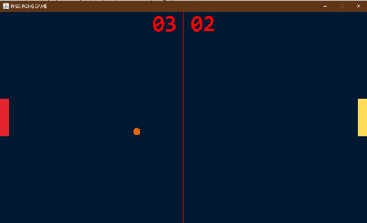
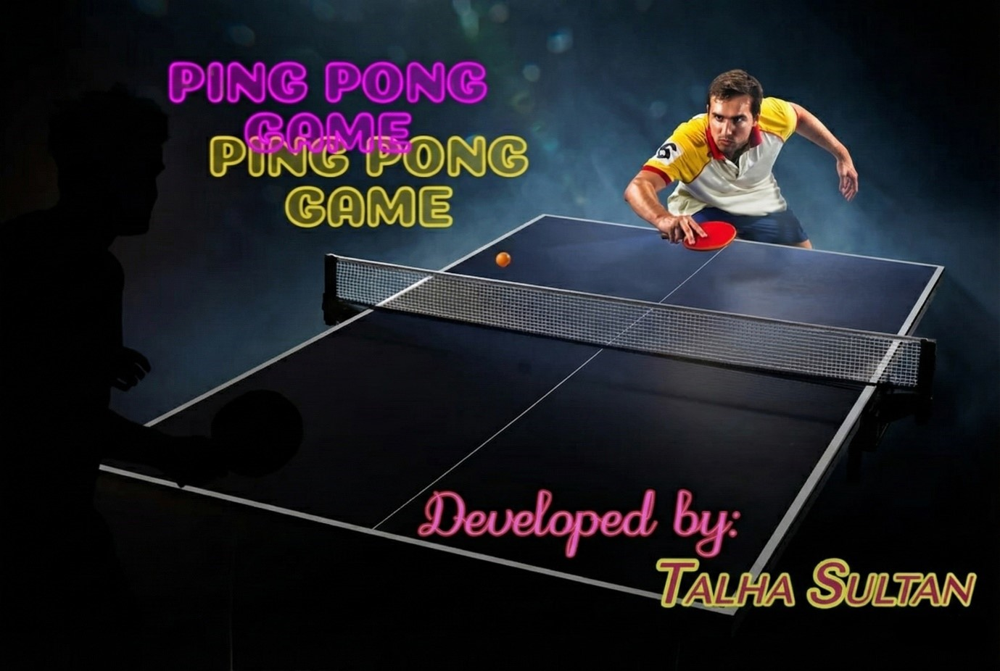
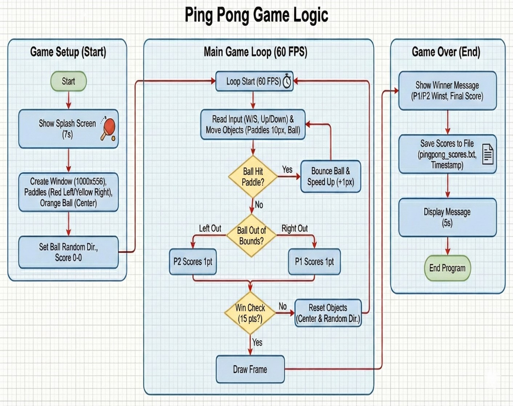

# 🏓 Ping Pong Game

**A two-player desktop arcade game developed using Java Swing and Object-Oriented Programming.**

Ping Pong Game is an interactive Java desktop application that recreates the classic Pong experience. It features keyboard-controlled paddles, dynamic ball movement, collision detection, real-time score tracking, and file-based game result storage.

The project demonstrates object-oriented software design, event-driven programming, graphical rendering, and fundamental game development concepts.

## Features

- **Two-Player Gameplay:** Two players compete locally using independent keyboard controls.
- **Real-Time Game Rendering:** Java Swing and AWT provide the graphical interface and render game objects.
- **Keyboard Controls:** Responsive paddle movement through keyboard input.
- **Collision Detection:** Ball interactions with paddles and game boundaries.
- **Dynamic Ball Movement:** Ball direction changes during gameplay.
- **Score Tracking:** Scores update when a player misses the ball.
- **Winner Detection:** The game determines the winner when the winning score is reached.
- **Score Persistence:** Game results are saved locally for future reference.

## Technology Stack

| Technology | Purpose |
|---|---|
| Java | Core programming language |
| Java Swing | Desktop GUI development |
| Java AWT | Graphics rendering and keyboard events |
| Object-Oriented Programming | Modular design and class-based architecture |
| File I/O | Persistent storage of game results |

## Object-Oriented Design

The application separates gameplay responsibilities across multiple Java classes.

| Class | Responsibility |
|---|---|
| `PongGame` | Game startup functionality |
| `MainWindow` | Introductory application interface |
| `GameFrame` | Main game window |
| `GamePanel` | Game rendering and gameplay coordination |
| `Ball` | Ball movement and behavior |
| `Paddle` | Paddle representation and movement |
| `Score` | Player scores and score display |

This separation improves code organization and makes individual gameplay components easier to understand and maintain.

## Gameplay Controls

| Player | Action | Key |
|---|---|---|
| Player 1 | Move paddle up | `W` |
| Player 1 | Move paddle down | `S` |
| Player 2 | Move paddle up | `↑` |
| Player 2 | Move paddle down | `↓` |

Players control their paddles to return the moving ball. A point is awarded when the opposing player fails to return it.

## Application Preview

### Gameplay

The main game window displays both paddles, the moving ball, and the live scoreboard.



### Introductory Screen

The application includes a custom introductory screen before gameplay begins.



## Game Logic and Workflow

The following flowchart illustrates the application's overall execution flow, including initialization, keyboard input, ball movement, collision detection, score updates, winner determination, and result storage.



## Getting Started

### Prerequisites

- Java Development Kit (JDK)
- Java-compatible terminal or IDE
- Windows, Linux, or macOS with a graphical desktop environment

### Clone the Repository

```bash
git clone https://github.com/talhasultan014/ping-pong-game.git
cd ping-pong-game
```

### Compile the Application

From the project root, compile the Java source files.

**Windows PowerShell:**

```powershell
javac -d out (Get-ChildItem -Path src -Recurse -Filter *.java).FullName
```

### Run the Application

```powershell
java -cp "out;src" java_GUI_Project_PINGPONG.MainWindow
```

The application should launch its introductory interface, allowing players to begin a game.

## Project Structure

```text
ping-pong-game/
├── src/
│   ├── icons/
│   └── java_GUI_Project_PINGPONG/
├── nbproject/
├── docs/
│   ├── screenshots/
│   │   ├── gameplay.png
│   │   └── intro-screen.png
│   └── diagrams/
│       └── game-flowchart.png
├── build.xml
├── manifest.mf
├── .gitignore
└── README.md
```

## Project Scope

This project focuses on local two-player gameplay, graphical interface development, game mechanics, and Java OOP principles. It is a desktop application rather than an online multiplayer game.

## Author

**Muhammad Talha Sultan**

GitHub: [@talhasultan014](https://github.com/talhasultan014)

---

*Developed as an academic Object-Oriented Programming project and presented as part of a software development portfolio.*